How can an AI model trained on **1,000 tokens** suddenly read and understand **4,000 tokens**? And when we stretch its memory, why do some of its internal "clock hands" need to slow down while others must keep spinning at full speed?

Most articles on **RoPE (Rotary Position Embedding)**, **Position Interpolation (PI)**, and **YaRN (Yet another RoPE extensioN)** throw walls of Greek letters at you without showing what happens to actual numbers.

In this guide, we will build the entire math of RoPE, PI, and YaRN **from first principles** using plain English and **one concrete, 8-number example** from start to finish. Every single section:

1. Tells you **what the math wants to say in simple words**.

2. Introduces the exact formula.

3. Plugs in our real numbers step-by-step.

4. Explains what the result physically means—and clears up common traps and misconceptions.

## The Big Idea in Two Sentences

Think of **RoPE** as attaching **four clock hands** (spinning at different speeds—from a super-fast millisecond hand to a slow hour hand) to every word so the AI can tell how far apart words are. When you feed the AI a book $4\times$ longer than it was trained on, **YaRN** leaves the fast clock hands alone (so neighboring words stay crystal clear), slows down the slow clock hands (so they don't spin past their training limit and confuse the AI), and turns up the volume of attention (so important words aren't drowned out by a $4\times$ larger crowd).

## Our Fixed Example Setup

We begin with a tiny three-word sentence: **"I like tea."**
Assume, just for this example, that each word is a single token. We will use the exact same numbers throughout the entire post so you can verify every calculation on a pocket calculator:

| Item | Value Used Throughout | Plain-English Meaning | 
| ----- | ----- | ----- | 
| **Tokens and positions** | `"I"` at $p=0$, `"like"` at $p=1$, `"tea"` at $p=2$ | Computers start counting positions at $0$. | 
| **Query/key head dimension** | $D = 8$ | Each word's Query or Key vector is a list of $8$ numbers ($4$ pairs of $2$ numbers). | 
| **RoPE base** | $b = 10000$ | The standard constant used in LLaMA and GPT-NeoX to space out clock speeds. | 
| **Query vector we will rotate** | $q = [1, 2, 3, 4, 5, 6, 7, 8]$ | Our test arrow for `"tea"` before any position twisting happens. | 
| **Original training length** | $L = 1000$ (positions $0$ through $999$) | The maximum document length the model ever saw during pre-training. | 
| **Extended context length** | $L_{\text{new}} = 4000$ (positions $0$ through $3999$) | The new, $4\times$ longer document length we want the model to handle. | 
| **Extension factor** | $s = L_{\text{new}} / L = 4000 / 1000 = 4$ | How many times longer our new context window is compared to training. | 
| **Long-distance test position** | $p = 3500$ | A position deep inside the new $4,000$-token zone (well past the old $999$ limit). | 

> **Controlled Experiment Note:** Later on, we will pick up our exact same query vector $q = [1, 2, 3, 4, 5, 6, 7, 8]$ and drop it at position $p = 3500$ to isolate the pure effect of position. In a real Transformer, query vectors depend on learned weight matrices and (in deeper layers) surrounding context, and real tokenizers can split a single word into multiple subword tokens.
>
> **Reading Convention:** All angles are measured in **radians** ($2\pi \approx 6.283\text{ rad} = 360^\circ$). Positive rotations turn **counterclockwise** starting from the positive horizontal ($x$) axis. Displayed numbers are rounded for readability, but all intermediate math uses full unrounded precision.

## 1. Why Attention Needs Positional Information

### What This Section Wants to Say

By default, a Transformer's attention mechanism is "position-blind"—it compares words purely by their meaning, like shaking words up in a bag. To understand language, the AI needs a way to stamp each word's Query and Key vectors with its **position** in the sentence *before* comparing them. RoPE does this by **twisting (rotating)** the Query and Key vectors by an angle proportional to their position.

### The Step-by-Step Breakdown

A Transformer compares tokens using **attention**. During training and prompt processing, all token positions are processed in parallel at the same time. During text generation (autoregressive decoding), new tokens are produced one by one.

However, comparing word meanings alone does not give the model relative-position structure. If the word `"tea"` appears at position $2$, the model needs to know whether a word like `"hot"` or `"like"` is sitting right next to `"tea"` (1 step away) or hundreds of words away in a different paragraph.

Inside a single attention head, a token at position $p$ starts with a hidden representation vector $h_p$. The model multiplies $h_p$ by learned weight matrices ($W_q$ and $W_k$) to produce a **Query vector (**$q_p$**)** and a **Key vector (**$k_p$**)**:

$$
q_p = W_q h_p, \qquad k_p = W_k h_p
$$

* **The Query (**$q_p$**):** Acts like a search request—it helps decide which other tokens this token wants to pay attention to.

* **The Key (**$k_p$**):** Acts like a label—it determines how well this token matches another token's search request.

To keep our math concrete, we assume those matrix multiplications have already happened for `"tea"`, giving us our 8-number Query vector:

$$
q = [1, 2, 3, 4, 5, 6, 7, 8]
$$

*(These numbers* $1$ *through* $8$ *are clean test coordinates so you can follow the arithmetic, not a literal dictionary definition of `"tea"`.)*

**Where RoPE enters:** Right after $q_p$ and $k_p$ are created—and right *before* the model computes their dot product—**RoPE** rotates the Query and Key vectors based on their position $p$ (Source: *RoFormer*). Notice that the **Value vector (**$v_p$**)** is *not* rotated in standard RoPE!

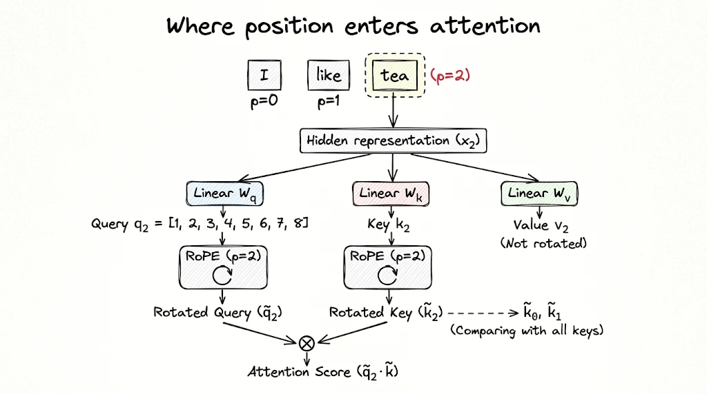

## 2. Turn the Eight Coordinates into Four Arrows

### What This Section Wants to Say

Rotating an 8-dimensional arrow in 8D space sounds terrifying. RoPE makes it effortless by **chopping the 8 numbers into 4 separate pairs of 2 numbers**. Any pair of 2 numbers $(x, y)$ is just a flat 2D arrow on a normal sheet of graph paper! We rotate each of the 4 arrows on its own 2D clock face, and then glue the 8 numbers back together.

### The Step-by-Step Breakdown

We group adjacent numbers in $q = [1, 2, 3, 4, 5, 6, 7, 8]$ into four 2D coordinate pairs:

$$
q = [\underbrace{1, 2}_{i=0}, \; \underbrace{3, 4}_{i=1}, \; \underbrace{5, 6}_{i=2}, \; \underbrace{7, 8}_{i=3}]
$$

| Pair Index ($i$) | Coordinate Indices in Vector | Starting 2D Arrow $(x, y)$ | Starting Length $\sqrt{x^2 + y^2}$ | 
| ----- | ----- | ----- | ----- | 
| **Pair 0** ($i=0$) | Slots $0$ and $1$ | $(1, 2)$ | $\sqrt{1^2 + 2^2} = \sqrt{5} \approx 2.24$ | 
| **Pair 1** ($i=1$) | Slots $2$ and $3$ | $(3, 4)$ | $\sqrt{3^2 + 4^2} = \sqrt{25} = 5.00$ | 
| **Pair 2** ($i=2$) | Slots $4$ and $5$ | $(5, 6)$ | $\sqrt{5^2 + 6^2} = \sqrt{61} \approx 7.81$ | 
| **Pair 3** ($i=3$) | Slots $6$ and $7$ | $(7, 8)$ | $\sqrt{7^2 + 8^2} = \sqrt{113} \approx 10.63$ | 

**Two Crucial Rules to Remember:**

1. **Every single word gets all four pairs (all four clocks):** We do *not* give Pair 0 to `"I"` and Pair 1 to `"like"`. The word `"I"` has all four arrows; the word `"like"` has all four arrows; the word `"tea"` has all four arrows.

2. **Storage order note:** Some codebases (like Hugging Face's LLaMA implementation) pair the first half of the vector with the second half (e.g., slot $0$ with slot $4$, slot $1$ with slot $5$). Mathematically, that works identically as long as you pair the same slots consistently. Here, we use adjacent pairs $(0,1), (2,3), (4,5), (6,7)$ throughout.

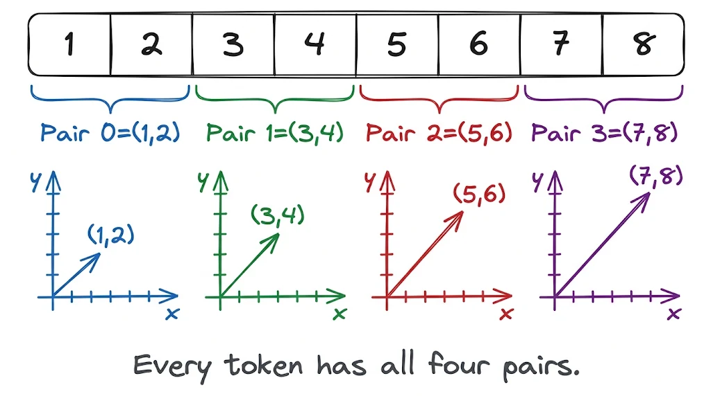

## 3. Calculate the Four Rotation Speeds

### What This Section Wants to Say

Why have 4 separate arrows if they all spin at the same speed? To measure both **short distances** (words right next to each other) and **long distances** (words pages apart), RoPE gives each pair a **different rotation speed (**$\theta_i$**)**—just like a watch has a fast second hand, a medium minute hand, and a slow hour hand. In our 8-number example, each pair spins **10 times slower** than the pair before it.

### The Step-by-Step Breakdown

RoPE assigns the rotation speed $\theta_i$ (in **radians per position step**) for pair $i$ using this formula:

$$
\boxed{\theta_i = b^{-2i/D} = \frac{1}{b^{2i/D}}}
$$

Let's plug in our base $b = 10000$ and head dimension $D = 8$ for each of our four pairs ($i = 0, 1, 2, 3$).
*(Helpful math fact:* $10000 = 10^4$*, so taking the fourth root* $10000^{1/4}$ *is simply* $10$*!)*

| Pair ($i$) | Formula Substitution | Exponent Simplification | Rotation Speed ($\theta_i$) | Clock-Hand Analogy | 
| ----- | ----- | ----- | ----- | ----- | 
| **Pair 0** | $1 / 10000^{2(0)/8}$ | $1 / 10000^0 = 1 / 1$ | $1\text{ rad/step}$ ($\approx 57.3^\circ\text{/step}$) | Super-fast millisecond hand | 
| **Pair 1** | $1 / 10000^{2(1)/8}$ | $1 / 10000^{1/4} = 1 / 10$ | $0.1\text{ rad/step}$ ($\approx 5.73^\circ\text{/step}$) | Fast second hand | 
| **Pair 2** | $1 / 10000^{2(2)/8}$ | $1 / 10000^{1/2} = 1 / 100$ | $0.01\text{ rad/step}$ ($\approx 0.57^\circ\text{/step}$) | Medium minute hand | 
| **Pair 3** | $1 / 10000^{2(3)/8}$ | $1 / 10000^{3/4} = 1 / 1000$ | $0.001\text{ rad/step}$ ($\approx 0.057^\circ\text{/step}$) | Slow hour hand | 

Putting all four speeds into a list gives:

$$
\boxed{\theta = [1, \; 0.1, \; 0.01, \; 0.001]}
$$

**Two Important Clarifications:**

* **Why is it a clean** $10\times$ **drop each step?** Because we chose $D = 8$, which makes $b^{2/D} = 10000^{2/8} = 10$. In a larger model where $D = 128$ (64 pairs), the speed still drops from $1$ down to $\approx 0.0001$, just in 64 smaller geometric steps instead of 4 big ones.

* **What does "higher dimensions rotate more slowly" mean?** You will often hear researchers say this. There is no mystical law of 8-dimensional physics that makes Pair 3 sluggish! It just means that in the formula $\theta_i = 10000^{-2i/D}$, we *chose* to assign smaller speed numbers to higher pair indices ($i=3$ gets $0.001$, while $i=0$ gets $1$).

## 4. Convert Position into an Angle

### What This Section Wants to Say

To find out **how far to twist** each arrow for a word at position $p$, you just multiply the **word's position (**$p$**)** by **that pair's speed (**$\theta_i$**)**. At position $0$ (`"I"`), every angle is $0$, so nothing twists. At position $2$ (`"tea"`), every pair twists twice as far as at position $1$ (`"like"`).

### The Step-by-Step Breakdown

The rotation angle $\phi_i(p)$ (in radians) applied to pair $i$ at token position $p$ is:

$$
\boxed{\phi_i(p) = p\theta_i}
$$

Let's multiply the position $p$ by the speed $\theta_i$ for all three words in `"I like tea"`:

| Pair ($i$) | Speed ($\theta_i$) | `"I"` at $p=0$ | `"like"` at $p=1$ | `"tea"` at $p=2$ | 
| ----- | ----- | ----- | ----- | ----- | 
| **Pair 0** | $1$ | $0(1) = \mathbf{0\text{ rad}}$ | $1(1) = \mathbf{1\text{ rad}}$ | $2(1) = \mathbf{2\text{ rad}}$ | 
| **Pair 1** | $0.1$ | $0(0.1) = \mathbf{0\text{ rad}}$ | $1(0.1) = \mathbf{0.1\text{ rad}}$ | $2(0.1) = \mathbf{0.2\text{ rad}}$ | 
| **Pair 2** | $0.01$ | $0(0.01) = \mathbf{0\text{ rad}}$ | $1(0.01) = \mathbf{0.01\text{ rad}}$ | $2(0.01) = \mathbf{0.02\text{ rad}}$ | 
| **Pair 3** | $0.001$ | $0(0.001) = \mathbf{0\text{ rad}}$ | $1(0.001) = \mathbf{0.001\text{ rad}}$ | $2(0.001) = \mathbf{0.002\text{ rad}}$ | 

So for `"tea"` at position $p=2$, the four twist angles we will apply to its four pairs are:

$$
\phi(2) = [2, \; 0.2, \; 0.02, \; 0.002]
$$

> **Watch Out for This Trap:** The numbers in the table above are **how much we twist the arrows**, *not* the final $(x,y)$ coordinates or directions of the arrows! For example, at $p=0$ (`"I"`), the twist angle is $0\text{ rad}$. That means the starting arrow $(7,8)$ stays untouched at $(7,8)$ (pointing up and right at $\approx 48.8^\circ$)—it does *not* reset the arrow to point horizontally along the $0^\circ$ axis!

### Reading a 3D Plot of Position, Pair Index, and Angle

Even though our vector has $8$ numbers, we can easily visualize how RoPE assigns angles across the whole prompt using a 3D chart:

| Plot Axis | Meaning | Values in Our Example | 
| ----- | ----- | ----- | 
| **X-axis** | Token position $p$ | $0, 1, 2$ initially; later $0$ through $3999$ | 
| **Y-axis** | Coordinate-pair index $i$ | Four discrete lanes: $0, 1, 2, 3$ | 
| **Z-axis (Height)** | Applied rotation angle $\phi_i(p)$ | Calculated from $p\theta_i$, in radians | 

* **What the Y-axis means:** Lane $3$ on the Y-axis simply means "Pair 3 (slots 6 and 7 of the vector)." It does *not* mean the vector lives in 3D physical space.

* **How to read a point:** The point $(X, Y, Z) = (2, 3, 0.002)$ means: *"At token position* $2$ *(`tea`), Pair* $3$ *receives a twist angle of* $0.002\text{ radians}$*."*

* **Why the lines are straight:** For each pair $i$, the angle $\phi_i(p) = p\theta_i$ grows in a **straight line** as position $p$ increases. The steepness (slope) of each line is simply that pair's rotation speed:

$$
\frac{\Delta \phi_i}{\Delta p} = \theta_i
$$

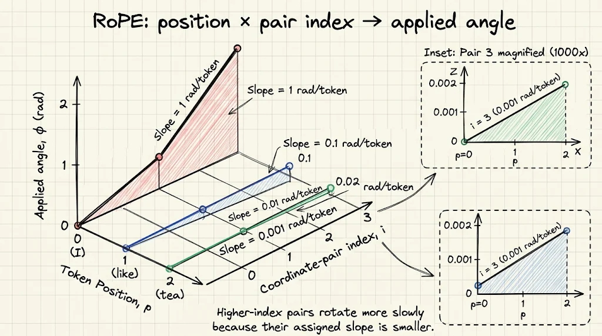

## 5. Rotate the Actual Eight-Dimensional Vector

### What This Section Wants to Say

Now we actually twist the 4 arrows of `"tea"` ($q = [1,2,3,4,5,6,7,8]$) at position $p=2$ using standard high-school sine and cosine rotation formulas. You will see that **Pair 0 swings wildly** (turning $2\text{ radians} \approx 114.6^\circ$), while **Pair 3 barely budges** (turning $0.002\text{ radians} \approx 0.11^\circ$). Most importantly, **none of the arrows change their length**!

### The Step-by-Step Breakdown

To rotate any 2D arrow $(x, y)$ counterclockwise by an angle $\phi$, we use these two formulas:

$$
\boxed{x' = x\cos\phi - y\sin\phi}
$$

$$
\boxed{y' = x\sin\phi + y\cos\phi}
$$

> **Where do these two formulas come from?**
> Any point $(x, y)$ is made of $x$ steps along the horizontal unit arrow $(1, 0)$ plus $y$ steps along the vertical unit arrow $(0, 1)$.
> When you rotate a graph counterclockwise by angle $\phi$:
>
> * The horizontal arrow $(1, 0)$ turns to $(\cos\phi, \; \sin\phi)$.
>
> * The vertical arrow $(0, 1)$ turns into Quadrant II to $(-\sin\phi, \; \cos\phi)$.
>   Adding $x$ copies of the first and $y$ copies of the second gives $x(\cos\phi, \sin\phi) + y(-\sin\phi, \cos\phi)$, which is $(x\cos\phi - y\sin\phi, \; x\sin\phi + y\cos\phi)$!

Now let's plug in all four pairs of `"tea"` at position $p=2$, where the angles are $\phi(2) = [2, \; 0.2, \; 0.02, \; 0.002]$:

#### Pair 0: Rotate $(1, 2)$ by $\phi_0 = 2\text{ radians}$ ($\approx 114.6^\circ$)

$$
\cos 2 \approx -0.416146837, \qquad \sin 2 \approx 0.909297427
$$

$$
\begin{aligned}
x' &= 1\cos 2 - 2\sin 2 \\
&\approx -0.416146837 - 1.818594854 \\
&\approx \mathbf{-2.234741690} \\
y' &= 1\sin 2 + 2\cos 2 \\
&\approx 0.909297427 - 0.832293673 \\
&\approx \mathbf{0.077003754}
\end{aligned}
$$

#### Pair 1: Rotate $(3, 4)$ by $\phi_1 = 0.2\text{ radians}$ ($\approx 11.5^\circ$)

$$
\cos 0.2 \approx 0.980066578, \qquad \sin 0.2 \approx 0.198669331
$$

$$
\begin{aligned}
x' &= 3\cos 0.2 - 4\sin 0.2 \\
&\approx 2.940199734 - 0.794677323 \\
&\approx \mathbf{2.145522410} \\
y' &= 3\sin 0.2 + 4\cos 0.2 \\
&\approx 0.596007992 + 3.920266311 \\
&\approx \mathbf{4.516274304}
\end{aligned}
$$

#### Pair 2: Rotate $(5, 6)$ by $\phi_2 = 0.02\text{ radians}$ ($\approx 1.15^\circ$)

$$
\cos 0.02 \approx 0.999800007, \qquad \sin 0.02 \approx 0.019998667
$$

$$
\begin{aligned}
x' &= 5\cos 0.02 - 6\sin 0.02 \\
&\approx 4.999000033 - 0.119992000 \\
&\approx \mathbf{4.879008033} \\
y' &= 5\sin 0.02 + 6\cos 0.02 \\
&\approx 0.099993333 + 5.998800040 \\
&\approx \mathbf{6.098793373}
\end{aligned}
$$

#### Pair 3: Rotate $(7, 8)$ by $\phi_3 = 0.002\text{ radians}$ ($\approx 0.11^\circ$)

$$
\cos 0.002 \approx 0.999998000, \qquad \sin 0.002 \approx 0.001999999
$$

$$
\begin{aligned}
x' &= 7\cos 0.002 - 8\sin 0.002 \\
&\approx 6.999986000 - 0.015999989 \\
&\approx \mathbf{6.983986011} \\
y' &= 7\sin 0.002 + 8\cos 0.002 \\
&\approx 0.013999991 + 7.999984000 \\
&\approx \mathbf{8.013983991}
\end{aligned}
$$

Glue all four rotated pairs back together into our 8-number rotated Query vector $\widetilde{q}_2$:

$$
\boxed{\widetilde{q}_2 \approx [
-2.234742, \; 0.077004, \;
2.145522, \; 4.516274, \;
4.879008, \; 6.098793, \;
6.983986, \; 8.013984]}
$$

Look at Pair 3 at the end: $(7, 8)$ barely shifted to $(6.984, 8.014)$. And if you check the squared length of any pair before and after—for example, Pair 3: $(-6.983986)^2 + (8.013984)^2 = 48.776 + 64.224 = 113 = 7^2 + 8^2$—**every arrow kept its exact original length**. Ordinary RoPE is a pure rotation!

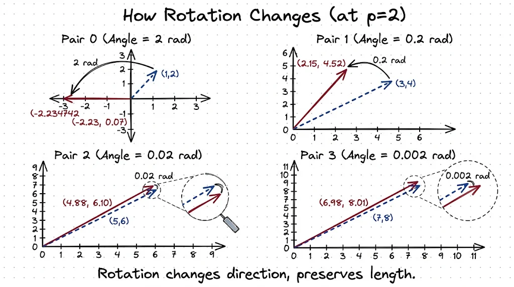

## 6. How This Creates Relative-Position Information

### What This Section Wants to Say

Why did we rotate the Query at position $m$ by $m\theta$ and the Key at position $n$ by $n\theta$? Because when attention calculates the **dot product** between two arrows, **only the angle *between* the two arrows matters!**

If you twist one arrow forward by $m\theta$ and another arrow forward by $n\theta$, the angle separating them only depends on their **relative distance** $(n - m)$! That means two adjacent words at positions $1$ and $2$ have the exact same positional relationship as two adjacent words at positions $3499$ and $3500$. **However**, comparing a word at $3500$ with a word at $0$ creates a relative distance of $3500$—a gap the model never saw inside a $1,000$-token training window!

### The Step-by-Step Breakdown

An attention dot product multiplies matching slots of the Query and Key vectors and adds all 8 products together:

$$
\widetilde{q}_m \cdot \widetilde{k}_n = \sum_{j=0}^{7} \widetilde{q}_{m,j} \widetilde{k}_{n,j} = \text{Pair}_0 + \text{Pair}_1 + \text{Pair}_2 + \text{Pair}_3
$$

Let's look at a single 2D pair using matrix notation. Writing our rotation formula from Section 5 as a $2 \times 2$ rotation matrix $R(\phi)$ gives:

$$
R(\phi) = \begin{bmatrix} \cos\phi & -\sin\phi \\ \sin\phi & \cos\phi \end{bmatrix}
$$

When we rotate a Query pair at position $m$ by $m\theta$ and a Key pair at position $n$ by $n\theta$:

$$
\widetilde{q}_m = R(m\theta)q_m, \qquad \widetilde{k}_n = R(n\theta)k_n
$$

Watch what happens when we take their dot product ($\widetilde{q}_m^\top \widetilde{k}_n$):

$$
\begin{aligned}
\widetilde{q}_m^\top \widetilde{k}_n &= q_m^\top R(m\theta)^\top R(n\theta) k_n \\
&= q_m^\top R(-m\theta) R(n\theta) k_n \\
&= \boxed{q_m^\top R((n - m)\theta) k_n}
\end{aligned}
$$

**Why did** $R(m\theta)^\top R(n\theta)$ **simplify to** $R((n-m)\theta)$**?**

1. Taking the transpose $R(m\theta)^\top$ of a rotation matrix simply reverses the rotation direction to $-m\theta$ (rotating clockwise by $m\theta$).

2. Rotating backward by $-m\theta$ and then forward by $+n\theta$ is just a single rotation by the difference $(n - m)\theta$!

**What this means in practice:**

* `"tea"` at $m=2$ and `"like"` at $n=1$ have a separation of $1$ step.

* A token at $m=3500$ and a token at $n=3499$ *also* have a separation of $1$ step. If they have the same content vectors and fixed frequencies, their positional dot-product contribution is **100% identical**!

* **Where the trouble starts:** When a token at $m=3500$ looks all the way back at a token at $n=0$, their separation is $3500$ **steps**. Inside a $1,000$-token training sequence (positions $0$ to $999$), no pair of tokens *ever* had a separation larger than $999$!

## 7. Why Calculate a Full Rotation?

### What This Section Wants to Say

To understand why a distance of $3500$ breaks **Pair 3** (the slow hour hand) while **Pair 0** (the fast millisecond hand) is completely fine, we need to ask: **"During the 1,000-word training window, how many full** $360^\circ$ **circles did each clock hand complete?"**

We will find that **Pair 0 spun** $159$ **full circles** during training—so spinning more circles at position $3500$ shows it nothing new. **Pair 3, however, only crept through** $15.9\%$ **of a single circle** during training!

### The Step-by-Step Breakdown

One full $360^\circ$ turn around a circle in radians is:

$$
2\pi \approx 6.283185\text{ radians}
$$

How many token steps ($\lambda_i$, called the **wavelength**) does it take for pair $i$ to complete one full $2\pi$ turn? Since $\text{angle} = \text{steps} \times \text{speed}$, we set the angle to $2\pi$:

$$
2\pi = \lambda_i \theta_i \implies \boxed{\lambda_i = \frac{2\pi}{\theta_i}}
$$

Once we know how many steps it takes to make 1 turn ($\lambda_i$), we can divide our training length ($L = 1000$) by $\lambda_i$ to see **how many full turns (**$r_i$**)** each pair makes across a 1,000-token training sequence:

$$
\boxed{r_i = \frac{L}{\lambda_i} = \frac{L\theta_i}{2\pi}}
$$

Let's calculate $\lambda_i$ and $r_i$ for all four pairs:

| Pair ($i$) | Full-Turn Distance Calculation ($\lambda_i = 2\pi / \theta_i$) | Steps for 1 Full Circle ($\lambda_i$) | Training-Turn Calculation ($r_i = 1000\theta_i / 2\pi$) | Full Circles Completed in Training ($r_i$) | 
| ----- | ----- | ----- | ----- | ----- | 
| **Pair 0** | $2\pi / 1$ | $6.283185\text{ tokens}$ | $1000(1) / (2\pi)$ | $159.154943\text{ turns}$ | 
| **Pair 1** | $2\pi / 0.1$ | $62.831853\text{ tokens}$ | $1000(0.1) / (2\pi)$ | $15.915494\text{ turns}$ | 
| **Pair 2** | $2\pi / 0.01$ | $628.318531\text{ tokens}$ | $1000(0.01) / (2\pi)$ | $1.591549\text{ turns}$ | 
| **Pair 3** | $2\pi / 0.001$ | $6283.185307\text{ tokens}$ | $1000(0.001) / (2\pi)$ | $0.159155\text{ turns}$ ($\approx 15.9\%$) | 

*(Convention note: Standard YaRN formulas use* $L = 1000$ *here, even though the exact span from token* $0$ *to token* $999$ *is* $999$ *steps).*

Look closely at **Pair 3 (the slowest pair)** during training (positions $0$ through $999$):

$$
0(0.001) \le \phi_3 \le 999(0.001) \implies \boxed{0 \le \phi_3 \le 0.999\text{ radians}}
$$

In degrees, $0.999\text{ radians}$ is only $57.2^\circ$—about $15.9\%$ **of a single circle** ($\frac{0.999}{2\pi} \approx 0.159$). To complete even ONE full circle, Pair 3 would need a prompt of $6,284\text{ tokens}$!

**Two Subtle Details Worth Noting:**

1. **Wavelengths don't need to be whole numbers:** For Pair 3, at token $6283$, the angle is $6.283\text{ rad}$ (just shy of $2\pi \approx 6.283185$). At token $6284$, it is $6.284\text{ rad}$ (just past $2\pi$). The underlying sine and cosine waves are continuous and finish their turn smoothly between those two integer tokens.

2. **Many cycles** $\neq$ **every exact angle:** Because token positions are whole numbers ($p = 0, 1, 2\dots$) and $\pi$ is irrational, Pair 0 never lands on the exact same decimal angle twice. Rather, $159$ turns means its discrete samples densely cover every region of the circle.

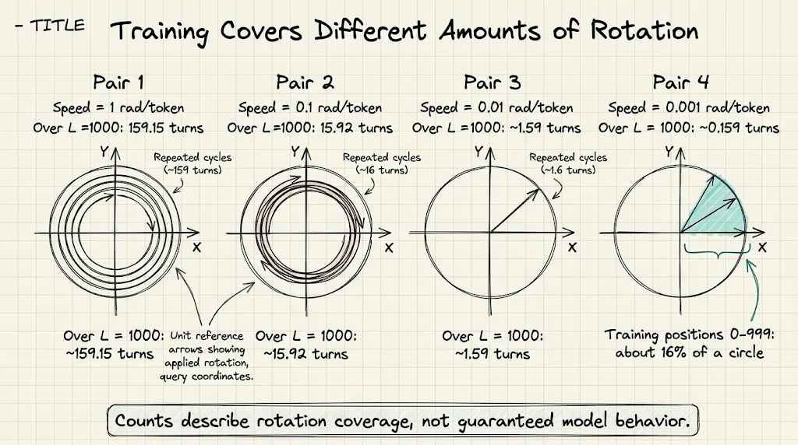

## 8. What Changes at Position 3500?

### What This Section Wants to Say

When you feed the AI a 4,000-word prompt and it reaches **word 3500**, the math doesn't crash with an error message—sine and cosine happily compute the new numbers.

What breaks is **Pair 3's positional phase**: during training, Pair 3 only ever twisted between $0$ and $0.999\text{ radians}$ ($0^\circ$ to $57.2^\circ$). At position $3500$, Pair 3 gets twisted by $3.5\text{ radians}$ **(**$200.5^\circ$**)**—more than halfway around the circle, flipping our $(7,8)$ arrow almost completely backward to $(-3.75, -9.95)$!

And here is a crucial distinction: the negative coordinates $(-3.75, -9.95)$ themselves are **not** foreign to the model (another word's starting vector could easily point there at position $0$). What is foreign is the $3.5\text{-radian}$ **relative twist** between two words, which can invert how attention scores matching content!

### The Step-by-Step Breakdown

Let's keep our query vector $q = [1, 2, 3, 4, 5, 6, 7, 8]$ fixed and move it to position $p = 3500$. Using $\phi_i = p\theta_i$:

$$
\phi(3500) = [3500(1), \; 3500(0.1), \; 3500(0.01), \; 3500(0.001)] = [3500, \; 350, \; 35, \; 3.5]
$$

Look at the fourth number—the slow pair's angle: $\phi_3 = 3.5\text{ radians}$ ($\approx 200.5^\circ$). That is more than $3.5\times$ beyond its maximum training angle of $0.999\text{ radians}$!

Let's rotate our slow pair $(7, 8)$ by $3.5\text{ radians}$:

$$
\cos 3.5 \approx -0.936456687, \qquad \sin 3.5 \approx -0.350783228
$$

$$
\begin{aligned}
x' &= 7\cos 3.5 - 8\sin 3.5 \\
&\approx -6.555196811 + 2.806265822 \\
&\approx \mathbf{-3.748930990} \\
y' &= 7\sin 3.5 + 8\cos 3.5 \\
&\approx -2.455482594 - 7.491653498 \\
&\approx \mathbf{-9.947136092}
\end{aligned}
$$

So at position $3500$, our slow arrow flips from Quadrant I into Quadrant III:

$$
(7, 8) \longrightarrow (-3.748931, \; -9.947136)
$$

**Clearing Up the Biggest Misconception About Why RoPE Fails Out-of-Bounds:**

* **Misconception:** *"The coordinates turned negative* $(-3.75, -9.95)$*, and the model has never seen negative coordinates in Quadrant III before!"*

* **Why that's false:** During training, at position $p=0$ (where zero rotation happens), some other word—say, `"coffee"`—could easily pass through $W_q$ and produce a starting arrow of $(-3.75, -9.95)$. The model has seen vectors pointing in all four quadrants thousands of times during training due to *content*.

* **What ACTUALLY fails:** What the model has never seen is a **relative positional twist** $R((n-m)\theta_3)$ **of** $3.5\text{ radians}$!

  * For example, during training ($0 \le \Delta p \le 999$), $\cos(\Delta p \cdot 0.001)$ was **always positive** (between $1.0$ and $0.541$), meaning two identical content vectors $(7,8)$ in Pair 3 *always* gave a positive boost to the attention dot product ($+113$ at $\Delta p=0$, gently fading to $+61$ at $\Delta p=999$).

  * At $\Delta p = 3500$, $\cos(3.5) \approx -0.936$ is **strongly negative**, so two identical $(7,8)$ vectors in Pair 3 suddenly produce a massive **negative penalty** ($(-3.7489)(7) + (-9.9471)(8) \approx -105.82$)! And because the total attention score adds all four pairs together ($\text{Pair}_0 + \text{Pair}_1 + \text{Pair}_2 + \text{Pair}_3$), Pair 3 turning against the other three pairs throws the whole sum out of calibration.

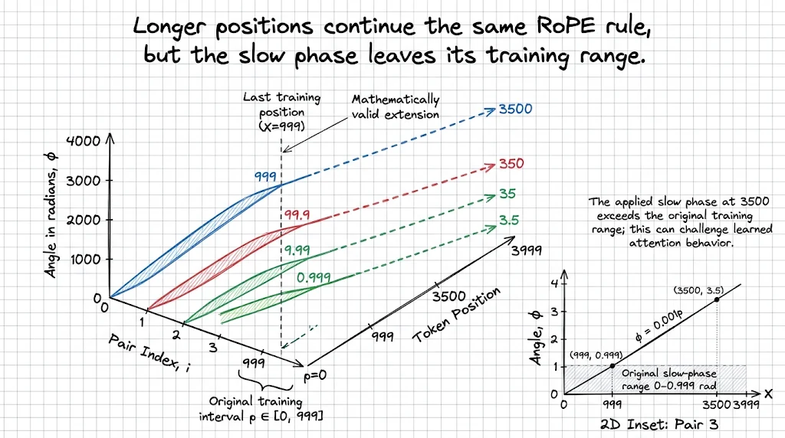

## 9. How a Slow Rotation Can Become a Positional Shortcut

### What This Section Wants to Say

Even though RoPE only measures **relative distance** between two words, an AI can easily use it to figure out its **exact absolute position** from the start of the document. How? By always comparing its current word at position $p$ to the **very first word at Position 0** (since $p - 0 = p$)!

In this section, we set up a clean mathematical experiment: we point the first token's Key arrow at an exact $90^\circ$ **right angle** to our Query arrow $(7,8)$. Because the Query arrow starts $90^\circ$ away from that Key, every step forward in the text turns the Query arrow *closer* to the Key, making their dot product climb smoothly from $0$ (at word $0$) up to $+0.841$ (at word $999$). If a model learns a lazy rule during training that relies on this climbing number (like *"When this score passes* $0.80$*, wrap up the essay!"*), that rule crashes at position $3500$ when the arrow spins too far and the score flips negative to $-0.351$!

### The Step-by-Step Breakdown

Let's keep our query's slow pair at $(7, 8)$ and choose the first token's key vector (at position $p=0$, like a `<BOS>` beginning-of-sequence token) to be:

$$
k_0 = [0, 0, 0, 0, 0, 0, -8, 7]
$$

Why did we choose these exact 8 numbers for $k_0$?

1. **Six zeros at the front:** Setting the first six slots to $0$ silences Pairs 0, 1, and 2 in the dot product ($0 + 0 + 0$), isolating **Pair 3** completely.

2. $(-8, 7)$ **at the end:** On a 2D grid, $(-8, 7)$ sits at an exact $90^\circ$ counterclockwise right angle (perpendicular) to $(7, 8)$, because their dot product at $p=0$ is zero:

$$
7(-8) + 8(7) = -56 + 56 = 0
$$

3. **Zero rotation at** $p=0$**:** Because this key sits at position $0$, RoPE applies $0$ rotation to it. It stands frozen like a stationary target at $(-8, 7)$.

Now move our Query token to position $p$. Its slow pair $(7, 8)$ rotates counterclockwise by $\phi = p(0.001)$—turning **directly toward** $(-8, 7)$! Let's compute their dot product $A(p)$:

$$
\begin{aligned}
A(p) &= (-8)(7\cos\phi - 8\sin\phi) + 7(7\sin\phi + 8\cos\phi) \\
&= -56\cos\phi + 64\sin\phi + 49\sin\phi + 56\cos\phi \\
&= (64 + 49)\sin\phi \\
&= \boxed{113\sin\phi}
\end{aligned}
$$

Notice how $-56\cos\phi$ and $+56\cos\phi$ canceled out completely! And $113$ is simply the squared length of our arrow ($7^2 + 8^2 = 49 + 64 = 113$).

To make this signal easy to read on a clean scale from $-1$ to $+1$, we divide $A(p)$ by the constant $113$:

$$
\boxed{S(p) = \frac{A(p)}{113} = \sin(p \times 0.001)}
$$

*(Important: Dividing by* $113$ *is just for our human dashboard—RoPE does not divide by* $113$ *in code, and* $S(p)$ *is a raw pre-softmax cue, not an attention probability).*

Look at how $S(p)$ behaves across the training window ($0$ to $999$) versus position $3500$:

| Position ($p$) | Angle Calculation ($\phi = p \times 0.001$) | Diagnostic $S(p) = \sin\phi$ | Physical Behavior of the Arrow | 
| ----- | ----- | ----- | ----- | 
| $0$ | $0(0.001) = 0\text{ rad}$ | $\sin 0 = \mathbf{0}$ | Query and Key are $90^\circ$ apart. | 
| $500$ | $500(0.001) = 0.5\text{ rad}$ ($\approx 28.6^\circ$) | $\sin 0.5 \approx \mathbf{0.479426}$ | Query turns closer to Key; score climbs. | 
| $875$ | $875(0.001) = 0.875\text{ rad}$ ($\approx 50.1^\circ$) | $\sin 0.875 \approx \mathbf{0.767544}$ | Query turns closer still; score keeps climbing. | 
| $999$ | $999(0.001) = 0.999\text{ rad}$ ($\approx 57.2^\circ$) | $\sin 0.999 \approx \mathbf{0.840930}$ | **Max training position!** Highest score seen in training. | 
| $3500$ | $3500(0.001) = 3.5\text{ rad}$ ($\approx 200.5^\circ$) | $\sin 3.5 \approx \mathbf{-0.350783}$ | **Overshot!** Query spun past the Key ($90^\circ$) and past $180^\circ$, flipping the score negative! | 

**Two Essential Takeaways:**

1. **How a shortcut forms and breaks:** Throughout training ($0$ to $999$), "later in the text" *always* meant a larger $S(p)$. If training data frequently places summaries or end-of-sequence responses near the end of 1,000-token chunks, a learned circuit could lazily rely on $S(p)$ being large. At position $3500$, $S(3500) \approx -0.351$ is smaller than at position $0$, breaking any rule that assumed "later always means larger." (This is a hypothetical mechanism illustrating what the math allows, not a claim about every trained LLM).

2. **Why "Progress Bar" is only an analogy (Odometer vs. Progress Bar):** A computer progress bar knows the total size of a file so it can show "$50\%$ complete." A causal LLM reads left-to-right one token at a time and **has no idea when the prompt will end**. At token $500$, $S(500) \approx 0.479$ is the exact same number whether the document ends at token $505$ or token $4000$. So $S(p)$ is really an **odometer** measuring distance from the starting anchor ($p - 0 = p$), not percentage of document completion!

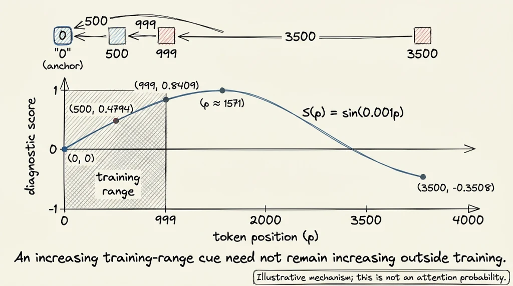

## 10. Position Interpolation: Fit More Positions into the Old Coordinate Interval

### What This Section Wants to Say

To stop Pair 3 from spinning past its $0.999\text{-radian}$ training limit when reading $4,000$ words, **Position Interpolation (PI)** uses a simple trick: **shrink the ruler by a factor of** $4$**!**

Instead of taking 1 full step per word ($0, 1, 2, \dots, 3999$), PI takes **quarter-steps** ($0, 0.25, 0.50, \dots, 999.75$) by dividing every position $p$ by $s = 4$. Now, when the AI is at Word $3500$, it plugs $3500 / 4 = \mathbf{875}$ into RoPE—bringing Pair 3's angle right back down from $3.5\text{ rad}$ to a safe, familiar $0.875\text{ rad}$!

### The Step-by-Step Breakdown

Our extension factor from $L = 1000$ to $L_{\text{new}} = 4000$ is:

$$
s = \frac{4000}{1000} = 4
$$

Position Interpolation (PI) replaces the raw position $p$ with a scaled **effective position**:

$$
\boxed{p_{\text{effective}} = \frac{p}{s}}
$$

Plugging $p_{\text{effective}}$ into the RoPE angle formula gives:

$$
\boxed{\phi_i^{\mathrm{PI}}(p) = \frac{p}{s}\theta_i}
$$

Look at how PI maps our 4,000 token positions into the old $[0, 1000)$ range:

| Actual Token Position ($p$) | Coordinate Calculation ($p / 4$) | Effective Coordinate ($p_{\text{effective}}$) | What Happens | 
| ----- | ----- | ----- | ----- | 
| $0$ (`"I"`) | $0 / 4$ | $0$ | Sits at the start. | 
| $1$ (`"like"`) | $1 / 4$ | $0.25$ | Quarter-step past $0$. | 
| $2$ (`"tea"`) | $2 / 4$ | $0.5$ | Halfway to old position $1$. | 
| $3500$ | $3500 / 4$ | $875$ | Pretends to be at old training position $875$! | 
| $3996$ | $3996 / 4$ | $999$ | Pretends to be at the old final training position $999$. | 
| $3999$ | $3999 / 4$ | $999.75$ | Final token of our 4,000-token sequence. | 

Now check our slow pair (**Pair 3**, $\theta_3 = 0.001$) at position $p = 3500$:

$$
\phi_3^{\mathrm{PI}}(3500) = \frac{3500}{4}(0.001) = 875(0.001) = \boxed{0.875\text{ radians}}
$$

Because $0.875$ sits safely inside the original $[0, 0.999]$ training range, Pair 3 no longer flips upside down!

**Two Crucial Clarifications:**

1. **We do NOT merge tokens or average vectors:** Every single one of the $4,000$ tokens stays completely separate. And how can a token sit at a fractional coordinate like $0.25$ or $0.5$? Because $\cos(\phi)$ and $\sin(\phi)$ are smooth, continuous waves that accept any decimal number! We simply evaluate $\cos(0.5\theta_i)$ and $\sin(0.5\theta_i)$ directly. We *never* linearly average two rotated arrows (averaging two arrows pointing in different directions shrinks their length, whereas evaluating $\cos$ and $\sin$ at $0.25$ keeps the exact original arrow length!).

2. **The Endpoint Detail (**$999.75$ **vs.** $999$**):** Because positions are zero-indexed, a 1,000-token window ends at $999$, and a 4,000-token window ends at $3999$. Using the standard convention $s = 4000 / 1000 = 4$ maps token $3996 \rightarrow 999.0$, while tokens $3997, 3998,$ and $3999$ land at $999.25, 999.50,$ and $999.75$—sticking out a tiny fraction of a step past the last old integer $999$ (while staying inside $[0, 1000)$). If you wanted token $3999$ to land on $999.0$ exactly, you would use $s = 3999/999 \approx 4.003$, though standard implementations simply use $s = L_{\text{new}}/L = 4$.

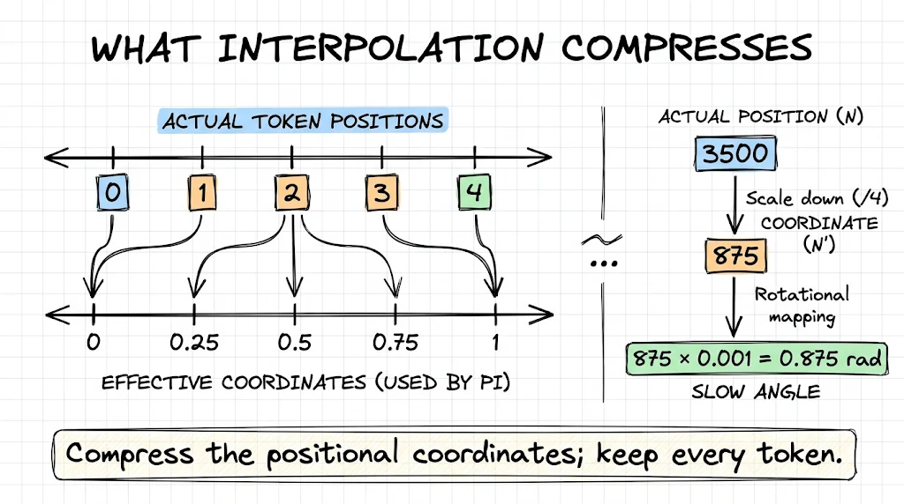

## 11. The Tradeoff: PI Also Slows the Fast Pairs

### What This Section Wants to Say

Position Interpolation saved our slow hour hand (Pair 3), **but what is the catch?**

By basic algebra, dividing the position $p$ by $4$ is the exact same thing as **dividing every clock hand's speed by** $4$! That means PI also slows down our **fastest clock hand (Pair 0)**—the hand the AI uses to tell neighboring words apart (like `"like"` at $1$ and `"tea"` at $2$).

Before PI, a 1-word step twisted Pair 0 by a bold $1\text{ radian}$ **(**$57.3^\circ$**)**, giving two identical reference arrows a cosine alignment of $0.54$. After PI slows Pair 0 down by $4$, a 1-word step barely nudges Pair 0 by $0.25\text{ radians}$ **(**$14.3^\circ$**)**, making the reference arrows $0.97$ aligned—crowding neighboring words much closer together in angle!

### The Step-by-Step Breakdown

Look at this simple rearrangement of the PI angle formula:

$$
\frac{p}{s}\theta_i = p\left(\frac{\theta_i}{s}\right)
$$

Dividing the coordinate $p$ by $s=4$ is mathematically identical to dividing **every pair's rotation speed** by $4$:

| Pair ($i$) | Original Speed ($\theta_i$) | PI Speed Calculation ($\theta_i / 4$) | New PI Speed ($\theta_i^{\mathrm{PI}}$) | Did This Pair Need Slowing Down? | 
| ----- | ----- | ----- | ----- | ----- | 
| **Pair 0** (Fastest) | $1$ | $1 / 4$ | $0.25$ | **No!** (Already spun $159$ turns in training) | 
| **Pair 1** | $0.1$ | $0.1 / 4$ | $0.025$ | **No!** (Already spun $15.9$ turns in training) | 
| **Pair 2** | $0.01$ | $0.01 / 4$ | $0.0025$ | **Maybe slightly** ($1.59$ turns in training) | 
| **Pair 3** (Slowest) | $0.001$ | $0.001 / 4$ | $0.00025$ | **Yes!** (Only $0.16$ turns in training) | 

Let's see how this affects two neighboring words: `"like"` at $p=1$ and `"tea"` at $p=2$ in our fastest pair (**Pair 0**):

* **Original RoPE 1-token angle gap:**

$$
\Delta\phi = (2 - 1)(1) = \mathbf{1\text{ radian}} \quad (\approx 57.3^\circ)
$$

* **PI 1-token angle gap:**

$$
\Delta\phi^{\mathrm{PI}} = (2 - 1)(0.25) = \mathbf{0.25\text{ radians}} \quad (\approx 14.3^\circ)
$$

To see how much this changes the geometry, hold content fixed by using two **unit reference arrows** (length $= 1$) that start pointing in the same direction. Their dot product is simply $\cos(\text{angle difference})$:

* **Originally (**$\Delta\phi = 1\text{ rad}$**):**

$$
\cos 1 \approx \mathbf{0.540302}
$$

* **After PI (**$\Delta\phi^{\mathrm{PI}} = 0.25\text{ rad}$**):**

$$
\cos 0.25 \approx \mathbf{0.968912}
$$

**What this means—and how not to exaggerate it:**

* The unit reference arrows for a 1-token gap are now much more aligned ($0.9689$ vs. $0.5403$). The local positional signal that pre-trained attention heads expect for adjacent words has shifted noticeably, which is why plain PI requires fine-tuning to recover sharp performance.

* **Caveat:** These numbers ($0.5403$ and $0.9689$) are reference-arrow alignments, *not* the actual attention scores of `"like"` and `"tea"` (whose learned Query and Key vectors differ in both length and starting direction). Nor does $\cos 0.25 \approx 0.9689$ prove that PI makes neighboring words "identical" or permanently destroys grammar—$0.9689$ is still distinct from $1.0$, and the perpendicular sine component $\sin 0.25 \approx 0.2474$ is clearly distinct from $\sin 0 = 0$.

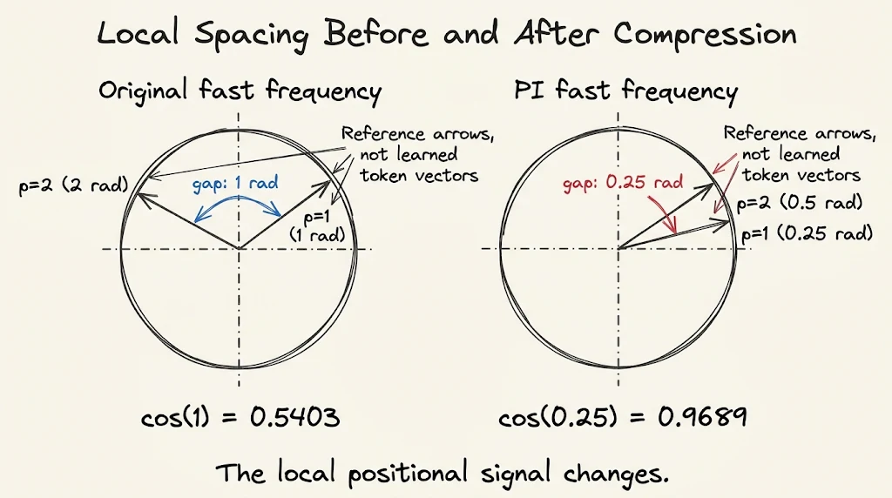

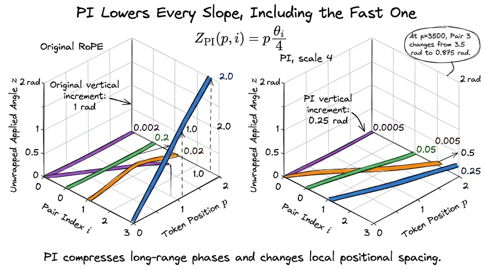

## 12. YaRN Changes Frequencies Selectively

### What This Section Wants to Say

Now we arrive at **YaRN**! Look at the dilemma we just uncovered:

* **Original RoPE** is great for **Pair 0** (keeps neighboring words $1\text{ rad}$ apart), but breaks on **Pair 3** at position $3500$.

* **Position Interpolation (PI)** fixes **Pair 3** at position $3500$, but ruins **Pair 0**'s sharp spacing for neighboring words.

YaRN's frequency rule—called **NTK-by-parts**—asks a brilliant question: **"Why not do BOTH?"**

* If a clock hand spun **32 full circles or more** during training ($\beta_{\text{fast}} = 32$), **keep its original fast speed (**$100\%$**)**!

* If a clock hand spun **1 full circle or less** during training ($\beta_{\text{slow}} = 1$), **slow it down by** $s=4$ **just like PI**!

* If a clock hand is **in between 1 and 32 circles**, **blend the two speeds smoothly** using a slider weight $\gamma_i$!

### The Step-by-Step Breakdown

Using the training-window rotation counts ($r_i$) from Section 7 and thresholds $\beta_{\text{slow}} = 1$ and $\beta_{\text{fast}} = 32$, YaRN divides frequencies into three buckets:

| Training-Window Rotations ($r_i$) | Which Pairs in Our Example? | YaRN Treatment | Slider Weight ($\gamma_i$) | 
| ----- | ----- | ----- | ----- | 
| **Small** ($r_i \le 1$, at/below $\beta_{\text{slow}}$) | **Pair 3** ($0.16$ turns) | **Full interpolation** (use slowed PI speed $\theta_i / s$) | $\gamma_i = 0$ | 
| **Between thresholds** ($1 < r_i < 32$) | **Pair 1** ($15.92$ turns) & **Pair 2** ($1.59$ turns) | **Smooth transition** (blend PI speed and original speed) | $0 < \gamma_i < 1$ | 
| **Large** ($r_i \ge 32$, at/above $\beta_{\text{fast}}$) | **Pair 0** ($159.15$ turns) | **Preserve original frequency** (keep $\theta_i$ untouched!) | $\gamma_i = 1$ | 

For every pair $i$, YaRN computes its new speed $\theta_i'$ using this blending formula:

$$
\boxed{\theta_i' = (1 - \gamma_i)\frac{\theta_i}{s} + \gamma_i\theta_i}
$$

Here, $\gamma_i$ (pronounced *"gamma"*) is the **weight on the original frequency**:

* When $\gamma_i = 0$: $\theta_i' = (1 - 0)\frac{\theta_i}{s} + 0 = \mathbf{\frac{\theta_i}{s}}$ (100% PI slowdown).

* When $\gamma_i = 1$: $\theta_i' = (1 - 1)\frac{\theta_i}{s} + 1\theta_i = \mathbf{\theta_i}$ (100% original speed preserved).

* When $0 < \gamma_i < 1$: It mixes $(1-\gamma_i)$ of the slowed PI speed with $\gamma_i$ of the original speed.

*(Vocabulary note: In this formula,* $\gamma_i$ *performs **frequency blending**—linearly mixing two speeds—whereas PI's "interpolation" means compressing positional coordinates* $p/s$*. The two uses of the word "interpolation" are related but distinct!)*

### Crucial Research Detail: Paper Ramp vs. Code Ramp

If you compare the YaRN paper (Section 3.2) with the official Hugging Face `transformers` implementation, they compute the middle slider weights $\gamma_i$ in two slightly different ways:

1. **The Paper's Ramp (Linear in Rotation Count** $r$**):**

$$
\gamma_{\text{paper}}(r) = \operatorname{clip}\left(\frac{r - 1}{32 - 1}, \; 0, \; 1\right)
$$

Because rotation counts $r_i$ drop by $10\times$ per pair ($159.15 \rightarrow 15.92 \rightarrow 1.59 \rightarrow 0.16$), plugging $r_i$ into a linear ruler from $1$ to $32$ bunches the middle weights unevenly ($\gamma_1 \approx 0.481145$ and $\gamma_2 \approx 0.019082$).
2. **The Code's Ramp (Linear in Pair Index** $i$**):**
Production code first converts the rotation thresholds ($32$ and $1$) into **pair indices**, rounds those endpoints to integers, and then steps **linearly across the pair index** $i$!

We use the **rounded index-ramp version** (matching the `transformers` codebase) for all remaining calculations so our walkthrough is $100\%$ reproducible in standard Python.

## 13. Derive the Actual Mixing Weights

### What This Section Wants to Say

Let's do the exact algebra used in the code to find our slider weights ($\gamma_i$) and new clock speeds ($\theta_i'$).

First, we solve the rotation formula backward to find which decimal pair index spins $32$ times ($i \approx 0.70$) and which spins $1$ time ($i \approx 2.20$). Rounding those outward gives Pair $0$ and Pair $3$ as our ramp endpoints. That splits our four pairs into clean steps of **one-third** ($\gamma = 1, \; \frac{2}{3}, \; \frac{1}{3}, \; 0$), giving us our final YaRN speeds: $[1, \; 0.075, \; 0.005, \; 0.00025]$!

### The Step-by-Step Breakdown

Start with the training-turn formula from Section 7 and solve it step-by-step for the pair index $i$:

1. **Start with turns** $r$**:**

$$
r = \frac{L\theta_i}{2\pi} = \frac{L}{2\pi}b^{-2i/D}
$$

2. **Isolate the exponent term (multiply by** $2\pi$**, divide by** $L$**):**

$$
\frac{2\pi r}{L} = b^{-2i/D}
$$

3. **Flip both sides upside down (take reciprocals) to remove the minus sign:**

$$
\frac{L}{2\pi r} = b^{2i/D}
$$

4. **Take the natural logarithm (**$\ln$**) of both sides to bring the exponent down:**

$$
\ln\left(\frac{L}{2\pi r}\right) = \frac{2i}{D}\ln b
$$

5. **Solve for the pair index** $i(r)$**:**

$$
\boxed{i(r) = \frac{D\ln(L / (2\pi r))}{2\ln b}}
$$

Now plug in $L = 1000$, $D = 8$, and $b = 10000$ for our two thresholds ($r = 32$ and $r = 1$):

* **Fast threshold (**$r = 32$ **turns):**

$$
i(32) = \frac{8\ln(1000 / (2\pi \cdot 32))}{2\ln 10000} \approx \mathbf{0.696670}
$$

* **Slow threshold (**$r = 1$ **turn):**

$$
i(1) = \frac{8\ln(1000 / (2\pi))}{2\ln 10000} \approx \mathbf{2.201820}
$$

The rounded implementation rounds the lower boundary **down** (floor $\lfloor \cdot \rfloor$) and the upper boundary **up** (ceiling $\lceil \cdot \rceil$) to lock onto integer pair indices:

$$
i_{\text{low}} = \lfloor 0.696670 \rfloor = \mathbf{0}, \qquad i_{\text{high}} = \lceil 2.201820 \rceil = \mathbf{3}
$$

Now define the **interpolation (slowdown) weight** $w_i$ and the **original-frequency preservation weight** $\gamma_i = 1 - w_i$:

$$
w_i = \operatorname{clip}\left(\frac{i - i_{\text{low}}}{i_{\text{high}} - i_{\text{low}}}, \; 0, \; 1\right), \qquad \gamma_i = 1 - w_i
$$

Substitute $i_{\text{low}} = 0$ and $i_{\text{high}} = 3$ for each pair:

| Pair ($i$) | Interpolation Weight $w_i = (i-0)/(3-0)$ | Original-Frequency Weight $\gamma_i = 1 - w_i$ | Meaning | 
| ----- | ----- | ----- | ----- | 
| **Pair 0** | $(0 - 0) / (3 - 0) = \mathbf{0}$ | $1 - 0 = \mathbf{1}$ | **100% Original**, 0% PI | 
| **Pair 1** | $(1 - 0) / (3 - 0) = \mathbf{1/3}$ | $1 - 1/3 = \mathbf{2/3}$ | **66.7% Original**, 33.3% PI | 
| **Pair 2** | $(2 - 0) / (3 - 0) = \mathbf{2/3}$ | $1 - 2/3 = \mathbf{1/3}$ | **33.3% Original**, 66.7% PI | 
| **Pair 3** | $(3 - 0) / (3 - 0) = \mathbf{1}$ | $1 - 1 = \mathbf{0}$ | **0% Original**, 100% PI | 

Now plug $\gamma_i$ into $\theta_i' = (1 - \gamma_i)\frac{\theta_i}{4} + \gamma_i\theta_i$ to get all four YaRN speeds:

* **Pair 0 (**$\gamma_0 = 1$**):**

$$
\theta_0' = (1 - 1)\frac{1}{4} + 1(1) = \boxed{1}
$$

* **Pair 1 (**$\gamma_1 = 2/3$**):**
  

  $$
  \begin{aligned}
  \theta_1' &= \left(1 - \frac{2}{3}\right)\frac{0.1}{4} + \frac{2}{3}(0.1) \\
  &= \frac{1}{3}(0.025) + \frac{2}{3}(0.1) \\
  &= 0.008333\ldots + 0.066666\ldots = \boxed{0.075}
  \end{aligned}
  $$

* **Pair 2 (**$\gamma_2 = 1/3$**):**
  

  $$
  \begin{aligned}
  \theta_2' &= \left(1 - \frac{1}{3}\right)\frac{0.01}{4} + \frac{1}{3}(0.01) \\
  &= \frac{2}{3}(0.0025) + \frac{1}{3}(0.01) \\
  &= 0.001666\ldots + 0.003333\ldots = \boxed{0.005}
  \end{aligned}
  $$

* **Pair 3 (**$\gamma_3 = 0$**):**

$$
\theta_3' = (1 - 0)\frac{0.001}{4} + 0(0.001) = \boxed{0.00025}
$$

Compare the speeds across all three methods side by side:

| Pair ($i$) | Original RoPE ($\theta_i$) | Position Interpolation ($\theta_i / 4$) | YaRN: Rounded Index Ramp ($\theta_i'$) | Percentage of Original Speed Kept by YaRN | 
| ----- | ----- | ----- | ----- | ----- | 
| **Pair 0** | $1$ | $0.25$ | $1$ | $100\%$ (Preserved!) | 
| **Pair 1** | $0.1$ | $0.025$ | $0.075$ | $75\%$ (Blended) | 
| **Pair 2** | $0.01$ | $0.0025$ | $0.005$ | $50\%$ (Blended) | 
| **Pair 3** | $0.001$ | $0.00025$ | $0.00025$ | $25\%$ (Fully interpolated!) | 

*(Note: If we had used the paper's rotation-count ramp instead, the middle weights* $\gamma_1$ *and* $\gamma_2$ *would be* $\approx 0.481145$ *and* $\approx 0.019082$*, giving slightly different middle speeds. Also note that while Pair 2's final speed* $0.005$ *happens to be half of* $0.01$*, its mixing weight* $\gamma_2$ *is* $1/3$*, not a* $50/50$ *weight of* $0.5$*!)*

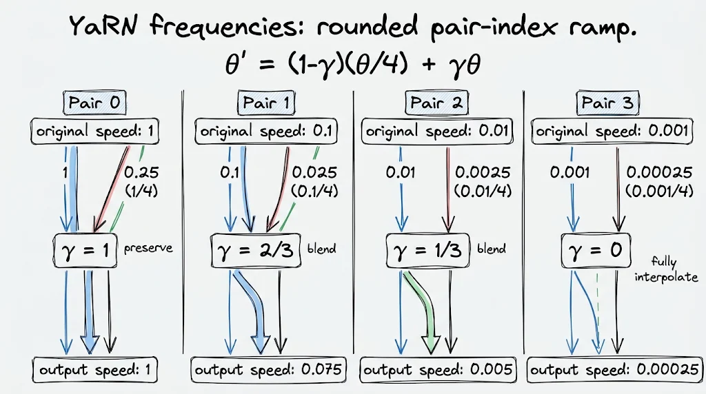


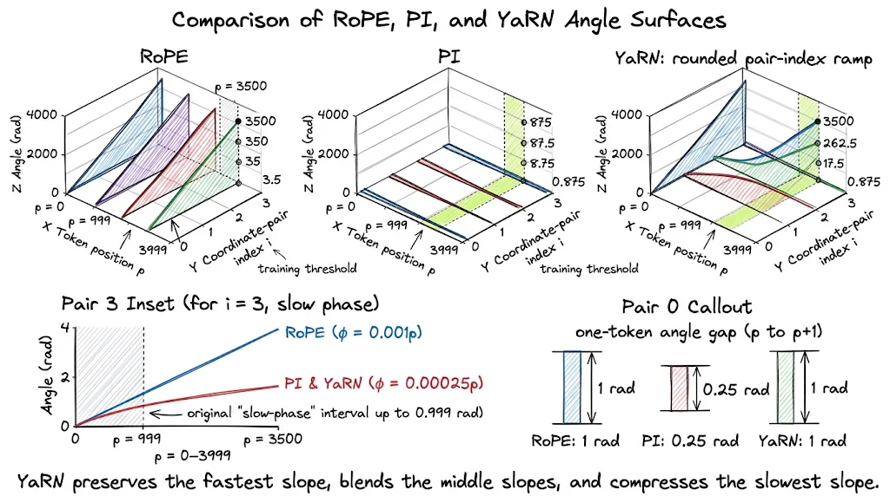

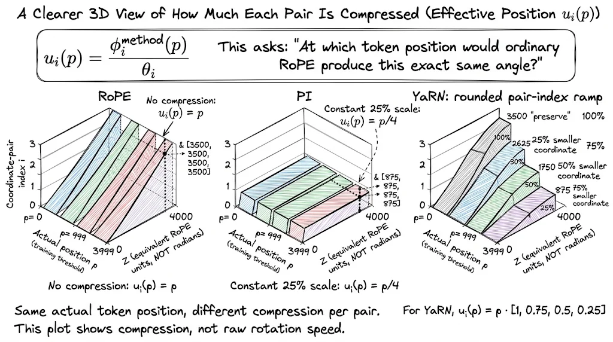

## 14. Rotate the Same Vector at Position 3500 with YaRN

### What This Section Wants to Say

Let's take our original 8-number Query vector $q = [1, 2, 3, 4, 5, 6, 7, 8]$ at position $p = 3500$ and rotate it using our new YaRN speeds $[1, \; 0.075, \; 0.005, \; 0.00025]$.

When we compare the final coordinates against Original RoPE and PI, you will see YaRN's magic in action:

* **Pair 0's coordinates** $(0.439555, \; 2.192440)$ **match Original RoPE** $100\%$ (preserving full local sharpness!).

* **Pair 3's coordinates** $(-1.653370, \; 10.500779)$ **match PI** $100\%$ (keeping the slow pair safely inside its training arc in Quadrant II instead of flipping upside down into Quadrant III!).

### The Step-by-Step Breakdown

First, multiply position $p = 3500$ by each pair's new YaRN speed $\theta_i'$:

$$
\boxed{\phi_i' = p\theta_i'}
$$

| Pair ($i$) | Angle Calculation ($3500 \times \theta_i'$) | YaRN Angle ($\phi_i'$) | Cosine ($\cos\phi_i'$) | Sine ($\sin\phi_i'$) | 
| ----- | ----- | ----- | ----- | ----- | 
| **Pair 0** | $3500(1)$ | $3500\text{ rad}$ | $0.964886893$ | $0.262665725$ | 
| **Pair 1** | $3500(0.075)$ | $262.5\text{ rad}$ | $0.176090457$ | $-0.984373989$ | 
| **Pair 2** | $3500(0.005)$ | $17.5\text{ rad}$ | $0.219439963$ | $-0.975626005$ | 
| **Pair 3** | $3500(0.00025)$ | $0.875\text{ rad}$ | $0.640996858$ | $0.767543502$ | 

*(Remember: large angles like* $3500\text{ radians}$ *are completely valid—sine and cosine wrap around every* $2\pi$ *radians automatically).*

Now apply the standard rotation formulas ($x' = x\cos\phi' - y\sin\phi'$ and $y' = x\sin\phi' + y\cos\phi'$) to each pair:

| Pair ($i$) | Starting $(x,y)$ | First Coordinate ($x'$) Calculation | Second Coordinate ($y'$) Calculation | 
| ----- | ----- | ----- | ----- | 
| **Pair 0** | $(1, 2)$ | $1\cos 3500 - 2\sin 3500 \approx \mathbf{0.439555}$ | $1\sin 3500 + 2\cos 3500 \approx \mathbf{2.192440}$ | 
| **Pair 1** | $(3, 4)$ | $3\cos 262.5 - 4\sin 262.5 \approx \mathbf{4.465767}$ | $3\sin 262.5 + 4\cos 262.5 \approx \mathbf{-2.248760}$ | 
| **Pair 2** | $(5, 6)$ | $5\cos 17.5 - 6\sin 17.5 \approx \mathbf{6.950956}$ | $5\sin 17.5 + 6\cos 17.5 \approx \mathbf{-3.561490}$ | 
| **Pair 3** | $(7, 8)$ | $7\cos 0.875 - 8\sin 0.875 \approx \mathbf{-1.653370}$ | $7\sin 0.875 + 8\cos 0.875 \approx \mathbf{10.500779}$ | 

Let's write out the slow pair (**Pair 3**) explicitly so you can verify every digit:

$$
\begin{aligned}
x' &\approx 7(0.640996858) - 8(0.767543502) = 4.486978007 - 6.140348018 \approx \mathbf{-1.653370011} \\
y' &\approx 7(0.767543502) + 8(0.640996858) = 5.372804516 + 5.127974865 \approx \mathbf{10.500779381}
\end{aligned}
$$

Gluing all four pairs back together gives the YaRN-rotated query at position $3500$ (before attention-strength scaling):

$$
\boxed{\widetilde{q}_{3500}^{\mathrm{YaRN}} \approx [
0.439555, \; 2.192440, \;
4.465767, \; -2.248760, \;
6.950956, \; -3.561490, \;
-1.653370, \; 10.500779]}
$$

Look at how all three methods compare at position $3500$:

| Pair ($i$) | Original RoPE at $3500$ | Position Interpolation (PI) at $3500$ | YaRN at $3500$ | 
| ----- | ----- | ----- | ----- | 
| **Pair 0** (Fastest) | $\mathbf{(0.439555, \; 2.192440)}$ | $(-2.061984, \; 0.864999)$ | $\mathbf{(0.439555, \; 2.192440)}$ *(Matches RoPE!)* | 
| **Pair 1** (Med-Fast) | $(2.984831, \; -4.011332)$ | $(4.474251, \; 2.231833)$ | $\mathbf{(4.465767, \; -2.248760)}$ *(Blended)* | 
| **Pair 2** (Med-Slow) | $(-1.949365, \; -7.563067)$ | $(-7.652572, \; -1.561454)$ | $\mathbf{(6.950956, \; -3.561490)}$ *(Blended)* | 
| **Pair 3** (Slowest) | $(-3.748931, \; -9.947136)$ | $\mathbf{(-1.653370, \; 10.500779)}$ | $\mathbf{(-1.653370, \; 10.500779)}$ *(Matches PI!)* | 

And for nearby tokens at positions $1$ and $2$, YaRN keeps Pair 0's angle gap at $(2 - 1)(1) = \mathbf{1\text{ radian}}$. We got the best of both worlds!

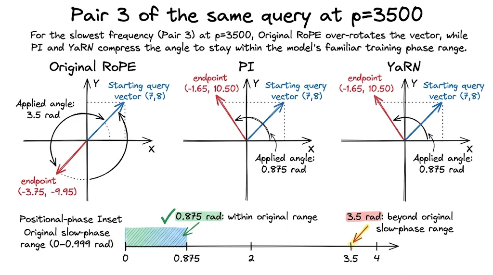

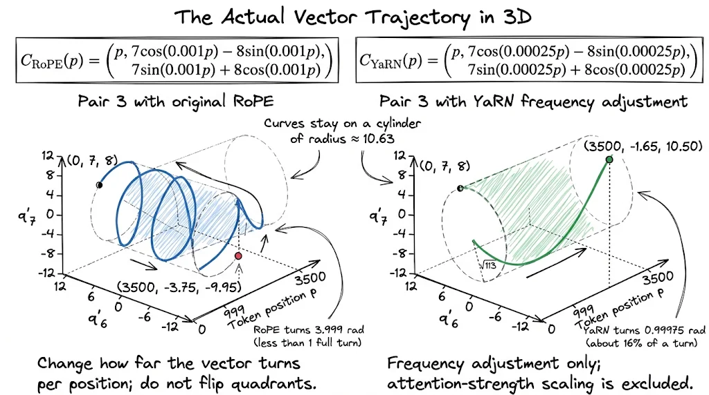

## 15. Does YaRN Remove the Shortcut?

### What This Section Wants to Say

Remember the "positional odometer shortcut" $S(p)$ from Section 9, where the AI used the dot product with Token 0 to guess how far into the document it was?

Does YaRN erase that shortcut? **No—it stretches (compresses) it so it doesn't wrap around and break!** Under YaRN, Position $3500$ produces the exact same $S(p) \approx +0.7675$ signal that Position $875$ used to produce during training.

### The Step-by-Step Breakdown

Returning to our same query and perpendicular first-token key $k_0 = [0,0,0,0,0,0,-8,7]$, the normalized diagnostic score under YaRN becomes:

$$
\boxed{S_{\mathrm{YaRN}}(p) = \sin(p \times 0.00025)}
$$

At position $p = 3500$:

$$
S_{\mathrm{YaRN}}(3500) = \sin(3500 \times 0.00025) = \sin 0.875 \approx \mathbf{0.767544}
$$

That is the exact same value that ordinary RoPE produced at position $875$:

$$
S_{\mathrm{RoPE}}(875) = \sin(875 \times 0.001) = \sin 0.875 \approx \mathbf{0.767544}
$$

| Old RoPE Position | New YaRN Position | Shared Slow Angle ($\phi_3$) | Shared Diagnostic Score $S(p)$ | 
| ----- | ----- | ----- | ----- | 
| $0$ | $0$ | $0\text{ rad}$ | $0$ | 
| $500$ | $2000$ | $0.5\text{ rad}$ | $0.479426$ | 
| $875$ | $3500$ | $0.875\text{ rad}$ | $0.767544$ | 
| $999$ | $3996$ | $0.999\text{ rad}$ | $0.840930$ | 

*(Note: Row* $3996$ *shows the exact coordinate match with old position* $999$*; the actual final token of a 4,000-token sequence is* $3999$*).*

**Two Honest Limitations to Keep in Mind:**

1. **Compressing a cue** $\neq$ **erasing a shortcut:** Because $S_{\mathrm{YaRN}}(p)$ still climbs smoothly from $0$ to $0.841$ across the 4,000-token window, YaRN prevents the signal from flipping negative at $3500$, but it does not magically erase a model's reliance on position cues.

2. **Static vs. Dynamic Scaling:** With our fixed $s = 4$, this slower speed ($0.00025$) is active *even if you only feed the model a short 500-word prompt*! Fixed YaRN does not know in advance whether your document will be $500$ tokens or $4,000$ tokens long (adjusting $s$ on the fly based on current sequence length is a separate option called *Dynamic Scaling*).

## 16. Why Attention Also Needs a Strength Adjustment

### What This Section Wants to Say

Up to this point, we have fixed the **angles** of the arrows. Why does Full YaRN also need a **second** step that stretches the **length** of the arrows?

Because of **Attention Dilution (The Crowd Noise Problem)**! After the AI computes raw dot-product scores (logits), it passes them through **Softmax**, which acts like a raffle where every word gets positive tickets ($e^z$) and all percentages must add up to $100\%$. Even a completely irrelevant background word ("distractor") with a score of $z = 0$ still gets $e^0 = 1$ **free raffle ticket**!

When you jump from $1,000$ words to $4,000$ words, adding $3,000$ extra distractor tickets into the raffle bucket waters down a strong matching word's attention share from $12.93\%$ **down to** $3.58\%$!

### The Step-by-Step Breakdown

Let's trace the two formulas that turn our rotated Query ($\widetilde{q}_m$) and rotated Key ($\widetilde{k}_n$) into an attention percentage ($a_{mn}$):

1. **The Scaled Attention Logit (**$z_{mn}$**):**

$$
\boxed{z_{mn} = \frac{\widetilde{q}_m^\top \widetilde{k}_n}{\sqrt{D}}}
$$

*(Dividing by* $\sqrt{D} = \sqrt{8}$ *is just standard 2017 Transformer attention scaling—it is completely separate from RoPE and YaRN).*

2. **The Softmax Probability (**$a_{mn}$**):**

$$
\boxed{a_{mn} = \frac{e^{z_{mn}}}{\sum_{j\ \mathrm{allowed}} e^{z_{mj}}}}
$$

Here, $e \approx 2.71828$. Raising $e$ to each score makes every weight strictly positive, and dividing by the sum forces all allowed weights to add up to $1.0$ ($100\%$).

### A Controlled Raffle Competition: 1,000 vs. 4,000 Tokens

To isolate the effect of adding more competing keys, let's run a clean test:

* Suppose **1 relevant target key** has a strong match logit of $z = 5$, which gives it $e^5 \approx 148.413159\text{ tickets}$.

* Every other allowed key is an irrelevant **distractor** with a logit of $z = 0$, which still gets $e^0 = 1\text{ ticket each}$.

* *(Note: These logits* $5$ *and* $0$ *are clean illustrative assumptions, not derived from our* $[1..8]$ *query. Also, we test at the **final query** of each sequence—position* $999$ *vs.* $3999$*—so a causal head can attend to all* $1,000$ *or* $4,000$ *positions; at position* $3500$*, it would only see* $3,501$ *allowed positions).*

With $N$ distractors, the relevant key's share of the raffle bucket is:

$$
\boxed{a_{\mathrm{relevant}} = \frac{e^5}{e^5 + N e^0}}
$$

Compare the relevant key's share in both windows:

* **1,000-Token Window (**$1$ **relevant key +** $N = 999$ **distractors):**

$$
a_{\mathrm{old}} = \frac{148.413159}{148.413159 + 999} \approx 0.129346 = \mathbf{12.9346\%}
$$

* **4,000-Token Window (**$1$ **relevant key +** $N = 3999$ **distractors):**

$$
a_{\mathrm{long}} = \frac{148.413159}{148.413159 + 3999} \approx 0.035785 = \mathbf{3.5785\%}
$$

Even though the relevant key matched the query just as strongly ($z=5$), quadrupling the crowd diluted its attention share from $12.93\%$ **down to** $3.58\%$! *(This illustrates why longer contexts benefit from attention-strength calibration, though in real prompts where many distractors have strongly negative logits, dilution isn't a rigid universal law).*

## 17. Calculate YaRN's Attention-Strength Factor

### What This Section Wants to Say

To rescue that diluted $3.58\%$ attention weight and bring it back up near $12.93\%$, YaRN makes the winning matches "speak louder" by stretching the length of every rotated Query and Key arrow by a factor $c \approx 1.1386$ ($13.86\%$ longer).

Because **both** the Query and the Key are multiplied by $c$, their dot product gets multiplied by $c^2 \approx 1.2965$ (a $29.65\%$ **score boost**!). That boosts our target word's logit from $5$ up to $6.48$, jumping its raffle tickets from $148$ up to $653$ **tickets**—while the $z=0$ distractors stay at $0 \times 1.2965 = 0$ ($1$ ticket each)! As a result, the relevant word's attention share recovers to $14.05\%$!

### The Step-by-Step Breakdown

For LLaMA-family models, the YaRN paper recommends this arrow-scaling formula (fitted empirically by testing on real models):

$$
\boxed{c = 1 + 0.1\ln s}
$$

Here, $\ln s$ is the natural logarithm ($\ln 4$ asks: *"what power on* $e \approx 2.71828$ *gives* $4$*?"*). For $s = 4$:

$$
\ln 4 \approx 1.386294361 \implies c = 1 + 0.1(1.386294361) \approx \boxed{1.138629436}
$$

We multiply **both** the rotated queries and the rotated keys by $c$:

$$
\widehat{q} = c\widetilde{q}, \qquad \widehat{k} = c\widetilde{k}
$$

When we take their dot product, the two $c$'s multiply together to give $c^2$:

$$
(c\widetilde{q})^\top (c\widetilde{k}) = c^2 \widetilde{q}^\top \widetilde{k}, \qquad \boxed{c^2 \approx 1.296476993}
$$

In Softmax terms, multiplying logits by $c^2 \approx 1.2965$ is identical to dividing logits by a cooler **attention temperature** $t$:

$$
\boxed{t = \frac{1}{c^2} \approx 0.771321054}, \qquad \operatorname{softmax}(c^2 z) = \operatorname{softmax}(z / t)
$$

Now let's plug $c^2 \approx 1.296476993$ into our 4,000-token raffle from Section 16:

1. **Relevant key's new logit:**

$$
z_{\mathrm{new}} = 5(1.296476993) \approx \mathbf{6.482384964}
$$

2. **Relevant key's new raffle tickets:**

$$
e^{6.482384964} \approx \mathbf{653.527729\text{ tickets}}
$$

3. **Distractor keys:** $0 \times 1.296476993 = 0 \implies e^0 = 1\text{ ticket each}$ ($3,999$ tickets total).

4. **Boosted attention share at 4,000 tokens:**

$$
a_{\mathrm{boosted}} = \frac{653.527729}{653.527729 + 3999} \approx 0.140467 = \mathbf{14.0467\%}
$$

| Controlled Raffle Setting | Relevant-Key Attention Share | 
| ----- | ----- | 
| **1,000 allowed keys**, original logits ($z=5$) | $12.9346\%$ | 
| **4,000 allowed keys**, original logits ($z=5$) | $3.5785\%$ *(Diluted!)* | 
| **4,000 allowed keys**, logits multiplied by $c^2$ ($z \approx 6.48$) | $14.0467\%$ *(Recovered!)* | 

**Three Essential Rules About Temperature Scaling:**

1. **Why multiply instead of adding a constant?** If you added $+1.48$ to *every* score, the distractors would also go up from $0$ to $+1.48$, multiplying everyone's tickets by $e^{1.48}$—which cancels out in the fraction and leaves Softmax $100\%$ unchanged! Multiplication stretches the **gap** between high scores and low scores.

2. **Temperature scaling cannot fix bad angles:** Multiplying by $c^2$ only makes the current 1st-place score win by a bigger margin. If the wrong key had the highest score (because you didn't fix the frequencies first), multiplying by $c^2$ would just make the model *more confident in its mistake*!

3. **Empirical tuning:** Landing at $14.05\%$ vs. $12.93\%$ depends on our chosen $z=5$ example; $c = 1 + 0.1\ln s$ is a general empirical rule, not an exact algebraic inverse for every distribution.

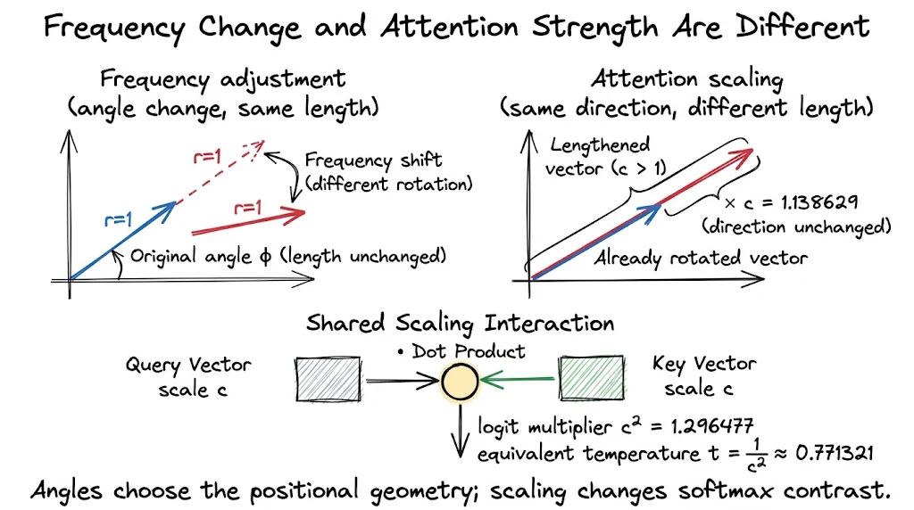

## 18. Finish the Calculation for Our Exact Query and Key

### What This Section Wants to Say

Let's bring everything together and finish the exact math for our rotated Query vector at position $3500$ and our first-token Key vector $k_0 = [0, 0, 0, 0, 0, 0, -8, 7]$!

We will stretch both vectors by $c \approx 1.138629$, compute their dot product, divide by $\sqrt{8}$, and arrive at the final YaRN attention logit of $39.755870$.

### The Step-by-Step Breakdown

Take our YaRN-rotated query vector $\widetilde{q}_{3500}$ from Section 14 and multiply every single coordinate by $c = 1.138629436$:

| Coordinate Slot | Rotated Value ($\widetilde{q}$) | Multiplication by $c = 1.138629436$ | Final YaRN Scaled Coordinate ($\widehat{q}$) | 
| ----- | ----- | ----- | ----- | 
| **Slot 0** (Pair 0, $x$) | $0.439555\ldots$ | $1.138629436 \times 0.439555\ldots$ | $0.500491$ | 
| **Slot 1** (Pair 0, $y$) | $2.192440\ldots$ | $1.138629436 \times 2.192440\ldots$ | $2.496376$ | 
| **Slot 2** (Pair 1, $x$) | $4.465767\ldots$ | $1.138629436 \times 4.465767\ldots$ | $5.084854$ | 
| **Slot 3** (Pair 1, $y$) | $-2.248760\ldots$ | $1.138629436 \times (-2.248760\ldots)$ | $-2.560504$ | 
| **Slot 4** (Pair 2, $x$) | $6.950956\ldots$ | $1.138629436 \times 6.950956\ldots$ | $7.914563$ | 
| **Slot 5** (Pair 2, $y$) | $-3.561490\ldots$ | $1.138629436 \times (-3.561490\ldots)$ | $-4.055218$ | 
| **Slot 6** (Pair 3, $x$) | $-1.653370\ldots$ | $1.138629436 \times (-1.653370\ldots)$ | $-1.882576$ | 
| **Slot 7** (Pair 3, $y$) | $10.500779\ldots$ | $1.138629436 \times 10.500779\ldots$ | $11.956497$ | 

So the complete, final YaRN-transformed query vector at position $3500$ is:

$$
\boxed{\widehat{q}_{3500} \approx [
0.500491, \; 2.496376, \;
5.084854, \; -2.560504, \;
7.914563, \; -4.055218, \;
-1.882576, \; 11.956497]}
$$

Meanwhile, our first token's key at $p=0$ had zero rotation ($\widetilde{k}_0 = [0, 0, 0, 0, 0, 0, -8, 7]$). Multiplying it by $c = 1.138629436$ gives:

$$
\widehat{k}_0 = c\widetilde{k}_0 \approx [0, \; 0, \; 0, \; 0, \; 0, \; 0, \; -9.109035, \; 7.970406]
$$

Now let's compute the final scaled attention logit $\widehat{z}_{3500, 0}$ step by step:

1. **Unscaled dot product (before** $c$**):**

$$
\widetilde{q}_{3500}^\top \widetilde{k}_0 = 113\sin(0.875) \approx \mathbf{86.732416}
$$

2. **Divide by** $\sqrt{D} = \sqrt{8} \approx 2.828427$**:**

$$
z_{3500, 0} = \frac{86.732416}{\sqrt{8}} \approx \mathbf{30.664540}
$$

3. **Multiply by YaRN's logit boost** $c^2 \approx 1.296476993$ **(or take** $\widehat{q}_{3500}^\top \widehat{k}_0 / \sqrt{8}$ **directly):**

$$
\widehat{z}_{3500, 0} = c^2 z_{3500, 0} \approx 1.296476993(30.664540) \approx \boxed{39.755870}
$$

*(Why is* $39.76$ *so large? Only because our toy vector* $[1..8]$ *and key* $[-8, 7]$ *have large whole numbers with length* $\sqrt{113} \approx 10.63$*; real learned neural network coordinates are much smaller decimals).*

To turn this single logit $\widehat{z}_{3500, 0} \approx 39.755870$ into a final attention probability $a_{3500, 0}$ and output vector $o_{3500}$, the Transformer needs the logits of all the other allowed keys ($j = 1 \dots 3500$) and their value vectors ($v_j$):

$$
a_{3500, 0} = \frac{e^{39.755870}}{e^{39.755870} + \sum_{j=1}^{3500} e^{\widehat{z}_{3500, j}}}, \qquad o_{3500} = \sum_{j=0}^{3500} a_{3500, j} v_j
$$

Since we haven't invented vectors for the other $3,500$ words in the book, we leave those final sums symbolic rather than making up a fake percentage!

### Summary of Our Complete 9-Step Path

1. Start with the eight query coordinates $q = [1, 2, 3, 4, 5, 6, 7, 8]$.

2. Calculate the four original RoPE speeds $\theta = [1, 0.1, 0.01, 0.001]$.

3. Use training-window rotation counts to compute YaRN's blended speeds $\theta' = [1, 0.075, 0.005, 0.00025]$.

4. Multiply the adjusted speeds by the token position $p = 3500$ to get angles $[3500, 262.5, 17.5, 0.875]$.

5. Rotate each 2D coordinate pair using $\cos$ and $\sin$.

6. Stretch the rotated Query and Key vectors by $c = 1 + 0.1\ln s \approx 1.138629$.

7. Compute the dot product and divide by $\sqrt{D} = \sqrt{8}$.

8. Apply Softmax across all allowed keys.

9. Use the resulting percentage weights to mix the Value vectors.

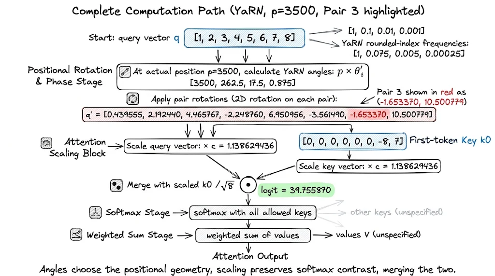

## 19. Why Fine-Tuning and Evaluation Still Matter

### What This Section Wants to Say

YaRN is an incredible mathematical bridge—in fact, it often lets models read longer prompts with *zero* extra training, or with $10\times$ fewer fine-tuning steps than Position Interpolation.

However, YaRN is **not magic pixie dust**. Even after YaRN fixes the clock speeds and boosts the attention strength, a short fine-tuning run on long texts is still hugely beneficial. Why? Because inside the AI's brain, changing the middle clock speeds changes how the 4 pairs add together!

### The Five Reasons Fine-Tuning Still Helps

1. **Fast and slow frequencies now combine differently:** Remember that the total dot product adds $\text{Pair}_0 + \text{Pair}_1 + \text{Pair}_2 + \text{Pair}_3$. During training, when Pair 3 was at $0.875\text{ rad}$ (which used to happen at token $875$), Pair 0 was at $875\text{ rad}$. Under YaRN, Pair 3 hits $0.875\text{ rad}$ at token $3500$, where Pair 0 is at $3500\text{ rad}$! The cross-frequency combinations are new.

2. **Intermediate frequencies still extrapolate:** Pairs 1 and 2 were only partially slowed down ($0.075$ and $0.005$), so at $p=3500$ they reach $262.5\text{ rad}$ and $17.5\text{ rad}$—beyond their training maximums of $99.9\text{ rad}$ and $9.99\text{ rad}$.

3. **More keys compete in Softmax:** Our $c^2$ boost helps counter dilution on average, but real attention distributions vary wildly across heads and layers.

4. **Information is separated by unfamiliar semantic distances:** Even if the clock angles are familiar, tracking a pronoun across $3,500$ words of story plot is harder than tracking it across $500$ words.

5. **Learned shortcuts may persist:** As we saw in Section 15, rescaling compresses position cues rather than deleting them.

*(Also remember: calling fast pairs "local" and slow pairs "global" is a helpful intuition about how fast their angles change with distance, not a strict law banning fast pairs from helping with long-range retrieval or slow pairs from carrying local meaning!)*

## 20. The Exact Changes, in One Master Table

Here is the entire journey from **Ordinary RoPE** to **Position Interpolation (PI)** to **YaRN**, summarized in one reference table:

| Component | Ordinary RoPE | Position Interpolation (PI, $s=4$) | YaRN (in this walkthrough, $s=4$) | 
| ----- | ----- | ----- | ----- | 
| **Frequencies (**$\theta_i$**)** | $1, \; 0.1, \; 0.01, \; 0.001$ | $0.25, \; 0.025, \; 0.0025, \; 0.00025$ | $1, \; 0.075, \; 0.005, \; 0.00025$ | 
| **Angle calculation** | $p\theta_i$ | $p\theta_i / 4$ | $p\theta_i'$ | 
| **Fastest-pair 1-token gap** | $1\text{ rad}$ ($\cos 1 \approx 0.5403$) | $0.25\text{ rad}$ ($\cos 0.25 \approx 0.9689$) | $1\text{ rad}$ ($\cos 1 \approx 0.5403$) | 
| **Slowest-pair angle at** $p=3500$ | $3.5\text{ rad}$ *(Out of training range!)* | $0.875\text{ rad}$ *(In training range)* | $0.875\text{ rad}$ *(In training range)* | 
| **Pair rotation formula** | Standard $\cos/\sin$ rotation | Same | **Same** | 
| **Additional query/key scale (**$c$**)** | $1$ (None) | $1$ (None in plain PI) | $c = 1 + 0.1\ln 4 \approx 1.138629436$ | 
| **Additional logit multiplier (**$c^2$**)** | $1$ (None) | $1$ (None in plain PI) | $c^2 \approx 1.296476993$ ($t \approx 0.771321$) | 
| **Removes all positional shortcuts?** | No | No | **No** | 
| **Guarantees perfect long-context use?** | No | No | **No** *(Fine-tuning & eval still matter)* | 

## Appendix A. Small Reproducible Python Example

This script uses **only Python's built-in `math` library** (zero external dependencies). Run it to verify every single number, vector, and assertion in this blog post!

```
import math

D = 8
BASE = 10_000.0
TRAIN_LENGTH = 1_000
NEW_LENGTH = 4_000
SCALE = NEW_LENGTH / TRAIN_LENGTH
QUERY = [1., 2., 3., 4., 5., 6., 7., 8.]
FIRST_KEY = [0., 0., 0., 0., 0., 0., -8., 7.]

def clip01(value):
    return min(1.0, max(0.0, value))

theta = [BASE ** (-2 * i / D) for i in range(D // 2)]

def correction_index(turns):
    return (
        D * math.log(TRAIN_LENGTH / (2 * math.pi * turns))
        / (2 * math.log(BASE))
    )

# For this example the rounded endpoints are 0 and 3.
low = math.floor(correction_index(32))
high = math.ceil(correction_index(1))
assert (low, high) == (0, 3)

gamma = [
    1 - clip01((i - low) / (high - low))
    for i in range(D // 2)
]
theta_pi = [frequency / SCALE for frequency in theta]
theta_yarn = [
    (1 - weight) * frequency / SCALE + weight * frequency
    for frequency, weight in zip(theta, gamma)
]

def rotate(vector, position, frequencies):
    assert len(vector) == 2 * len(frequencies)
    output = []
    for i, frequency in enumerate(frequencies):
        x, y = vector[2 * i : 2 * i + 2]
        angle = position * frequency
        cosine, sine = math.cos(angle), math.sin(angle)
        output.extend([
            x * cosine - y * sine,
            x * sine + y * cosine,
        ])
    return output

def dot(a, b):
    return sum(x * y for x, y in zip(a, b))

def display(values):
    return [round(value, 6) for value in values]

print("Original speeds:", theta)
print("PI speeds:", theta_pi)
print("Preservation weights:", gamma)
print("YaRN speeds:", theta_yarn)

for name, frequencies in [
    ("RoPE", theta),
    ("PI", theta_pi),
    ("YaRN rotations", theta_yarn),
]:
    for position in [2, 3500]:
        result = rotate(QUERY, position, frequencies)
        print(name, position, display(result))
        # Pure rotations preserve the vector's squared length.
        assert math.isclose(dot(result, result), 204.0, rel_tol=1e-12)

c = 1 + 0.1 * math.log(SCALE)
q_rotated = rotate(QUERY, 3500, theta_yarn)
k_rotated = rotate(FIRST_KEY, 0, theta_yarn)
q_scaled = [c * value for value in q_rotated]
k_scaled = [c * value for value in k_rotated]

logit_before = dot(q_rotated, k_rotated) / math.sqrt(D)
logit_after = dot(q_scaled, k_scaled) / math.sqrt(D)

assert math.isclose(
    logit_after, c * c * logit_before, rel_tol=1e-12
)
assert math.isclose(
    dot(q_rotated, k_rotated) / 113,
    math.sin(0.875),
    rel_tol=1e-12,
)
print("Full YaRN query:", display(q_scaled))
print("c:", c, "logit multiplier:", c * c)
print("Exact toy key logit before/after:", logit_before, logit_after)

# Separate controlled competition experiment.
# Logit 5 is an illustrative assumption, not the toy query's logit.
def relevant_weight(logit, distractor_count):
    # Algebraically equivalent to exp(logit)/(exp(logit)+N),
    # with zero logits for all distractors.
    return 1 / (1 + distractor_count * math.exp(-logit))

print("1000 keys:", relevant_weight(5, 999))
print("4000 keys:", relevant_weight(5, 3999))
print("4000 keys, scaled:", relevant_weight(5 * c * c, 3999))

```

## Sources and Scope

The numerical examples and diagrams in this guide are worked educational examples designed to make the underlying mathematics concrete; they are not measurements from a specific trained model.

1. **Su et al. (2021)**, *RoFormer: Enhanced Transformer with Rotary Position Embedding* — RoPE's formulation and relative-position dot-product identity.

2. **Chen et al. (2023)**, *Extending Context Window of Large Language Models via Positional Interpolation* — Position Interpolation (PI) and context-extension fine-tuning experiments.

3. **Peng et al. (2023)**, *YaRN: Efficient Context Window Extension of Large Language Models* — Sections 3.2 and 3.3 cover NTK-by-parts frequency blending and attention temperature scaling.

4. **YaRN Authors' Repository** (`jquesnelle/yarn`) — Reference implementations and released long-context models.

5. **Hugging Face `transformers` RoPE Utilities** — Code reference for the rounded pair-index ramp (`low` / `high` floor and ceiling endpoints) used throughout this walkthrough.

*Scope note:* This walkthrough assumes all eight head coordinates receive RoPE, uses a fixed scaling factor $s = 4$, and omits architecture-specific variations such as partial rotary dimensions (`rotary_pct < 1.0`) and dynamic runtime scaling.
